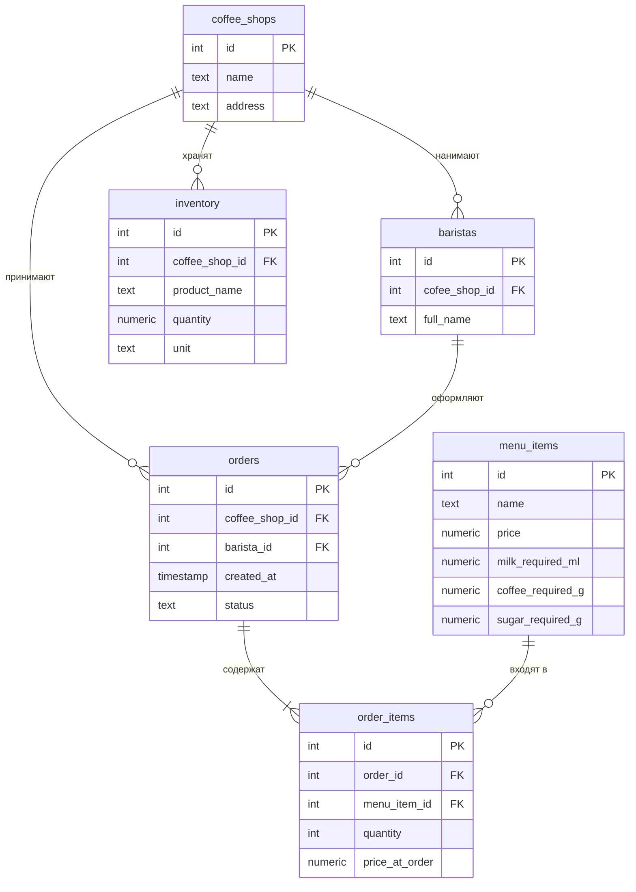

<!--
  Это шаблон. После создания своего репозитория:
  1. Назовите репозиторий db-<фамилия>-<тема>, например db-ivanova-cinema.
  2. Заполните разделы ниже под свою тему и удалите этот комментарий.
-->

# Название проекта

Тема № _24_: **Сеть кофеен**. Хранит информацию о кофейнях, бариста, меню, заказах, ингредиентах и складских остатках, нужна управляющим для контроля продаж и запасов,для оформления заказов и контроля наличия ингредиентов.

| | |
| --- | --- |
| Главная таблица | orders |
| Связь N:M | orders и menu_items  через `order_items` |
| Бизнес-правило | Нельзя оформить заказ на напитки, если запасов необходимых ингредиентов в выбранной кофейне нет |
| СУБД | PostgreSQL 17 в Docker |

## Задания курса

Правила курса, установка и порядок сдачи: [docs/README.md](docs/README.md).

| Лаба | Задание |
| --- | --- |
| 1. Модель данных и схема | [docs/lab-1.md](docs/lab-1.md) |
| 2. Запросы | [docs/lab-2.md](docs/lab-2.md) |
| 3. Логика в базе | [docs/lab-3.md](docs/lab-3.md) |
| 4. Транзакции и доступ | [docs/lab-4.md](docs/lab-4.md) |
| 5. Производительность | [docs/lab-5.md](docs/lab-5.md) |
| Витрина к защите | [docs/showcase.md](docs/showcase.md) |

## Как запустить

```bash
cp .env.example .env          # пароли и порт
docker compose up -d          # при первом запуске выполняются скрипты из db/
dbcheck run demo/lab1.sql     # сценарий лабы 1
```

Работа с базой: `docker compose exec db psql -U postgres -d app`. Сценарии выполняются в `psql` командой `\i /demo/lab1.sql`.

После изменения скриптов в `db/` базу нужно пересоздать: `docker compose down -v && docker compose up -d`.

## ER-диаграмма

<!-- Замените пример своими таблицами: 5+ таблиц, связь N:M через связующую таблицу. -->
<!-- || — ровно один
o{ — ноль или много
|{ — один или много
-->



## Ограничения

| Ограничение | Таблица и колонки | Зачем |
| --- | --- | --- |
| `PRIMARY KEY` |	Все таблицы |Уникальный ключ, на который могут ссылаться внешние ключи (FK) других таблиц |
| `FOREIGN KEY` | `cofee_shop_id`, `orders.coffee_shop_id`, `orders.barista_id`, `order_items.order_id`, `order_items.menu_item_id`, `inventory.coffee_shop_id` | Связь с существующими записями|
| `UNIQUE` | `coffee_shops.name`, `inventory.coffee_shop_id, inventory.product_name` (составное ограничение)  | Не допускает дублирования|
| `CHECK` | `menu_items.price > 0`, `order_items.price_at_order >= 0`, `inventory.quantity >= 0` | Ограничения |
| `NOT NULL` | `orders.coffee_shop_id`, `orders.barista_id`, `orders.created_at`, `orders.status`, `menu_items.name`, `menu_items.price`, `order_items.order_id`, `order_items.menu_item_id`, `order_items.quantity`, `order_items.price_at_order`, `inventory.coffee_shop_id`, `inventory.product_name`, `inventory.quantity`, `inventory.unit` | Не может быть пустым|

## Нормализация

Нормализация — это разделение данных на связанные таблицы, чтобы убрать повторы и избежать ошибок при изменении данных.

### Исходная таблица

Все данные хранятся в одной таблице, поэтому адрес кофейни и имя бариста повторяются в каждом заказе.

| Заказ | Кофейня | Адрес | Бариста | Напиток |
|---|---|---|---|---|
| 1 | Центральная | ул. Ленина, 1 | Анна Иванова | Капучино |
| 2 | Центральная | ул. Ленина, 1 | Анна Иванова | Латте |

Если адрес изменится, его придётся менять в нескольких строках.

### 1НФ — одно значение в ячейке

В каждой ячейке хранится одно значение. Несколько напитков одного заказа записываются отдельными строками.

| Заказ | Напиток | Количество |
|---|---|---:|
| 1 | Капучино | 2 |
| 1 | Латте | 1 |

### 2НФ — данные зависят от всего ключа

Информация о заказе и напитках разделяется. Для позиций заказа создаётся отдельная таблица `order_items`.

| order_id | menu_item_id | quantity |
|---:|---:|---:|
| 1 | 3 | 2 |
| 1 | 4 | 1 |

### 3НФ — каждый вид данных хранится отдельно

Данные о кофейнях, бариста и напитках выносятся в отдельные таблицы. Заказы ссылаются на них через внешние ключи.

| Таблица | Что хранит |
|---|---|
| `coffee_shops` | Название и адрес кофейни |
| `baristas` | Имя бариста и его кофейню |
| `menu_items` | Название и цену напитка |
| `orders` | Информацию о заказах |
| `order_items` | Напитки внутри заказов |
| `inventory` | Остатки продуктов |

**Результат:** данные не приходится дублировать во множестве строк, а изменения можно выполнять в одном месте.

## Что сделано по лабам

| Лаба | Что сделано | Сценарий |
| --- | --- | --- |
| 1 | ... | `demo/lab1.sql` |
| 2 | ... | `demo/lab2.sql` |
| 3 | ... | `demo/lab3.sql` |
| 4 | ... | `demo/lab4.sql`, `demo/race.sql`, `demo/race_fixed.sql` |
| 5 | ... | `demo/lab5.sql` |

<!--
  Разделы, которые добавляются по ходу курса:
  лаба 1 ★: «Нормализация», «Типы данных»; ★★: «Что происходит при удалении»;
  лаба 4: «Гонка»;
  лаба 5: «Производительность» (таблица до / после, когда индекс не помогает, размеры).
-->
